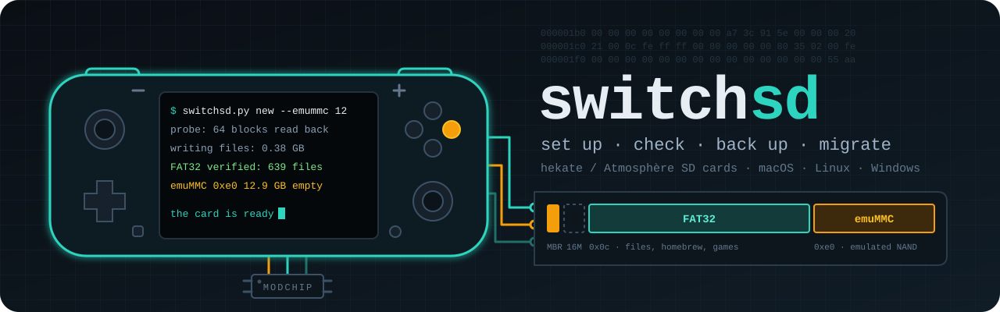

# switchsd

[](LICENSE)
[](#requirements)
[](#requirements)
[](#requirements)
[](#requirements)
[](docs/homebrew.md)
[](#what-has-been-tested)

<p align="center">
  
</p>

`switchsd.py` sets up, checks, backs up and migrates the SD card of a Nintendo Switch that runs
hekate and Atmosphère. It is plain Python with nothing to install, for macOS, Linux and Windows.

New to hekate and Atmosphère? [How it all fits together](docs/guide.md) explains the pieces and
what to do, in order.

Before you use it:

- It is for a console that already starts hekate: one with a modchip, or a first-generation Switch
  in RCM. It prepares cards. It does not install a modchip, exploit a console, or provide firmware
  or games.
- Before anything else on the console, back up its own storage with hekate, as
  [the guide](docs/guide.md#back-up-the-consoles-own-storage) shows. switchsd backs up cards, not
  the console.
- Custom firmware can get a console banned from Nintendo's online services; that risk is yours.
- So far it has run with one Switch Lite, from one Mac.
  [What has been tested](#what-has-been-tested) says how far each command has got.

Questions and problems go in this repository's Issues.

## Quick start

With the console's SD card in the computer's card reader, one line does it:

```sh
git clone https://github.com/26zl/switchsd && cd switchsd && python3 switchsd.py setup
```

`setup` finds the card and installs or updates hekate, Atmosphère and the homebrew that
`switchsd.py list` shows. It never touches the emuMMC, `Nintendo/`, saves or your settings, and
`--dry-run` shows first what it would change. When it is done, it lists what is left to do on the
console, such as putting tico on the HOME menu. On Windows, in PowerShell:
`git clone https://github.com/26zl/switchsd; cd switchsd; py switchsd.py setup`. Without git,
GitHub's Code > Download ZIP gives the same folder.

It finds a card that hekate already starts from. A new or empty card has to be named, or built
with [`new`](#new-cards-backups-and-bigger-cards):

```sh
python3 switchsd.py setup "/Volumes/SWITCH SD"      # the card's folder
python3 switchsd.py check                           # what is missing, wrong or risky on it
```

| System | The card's folder | Python |
| --- | --- | --- |
| macOS | `/Volumes/SWITCH SD` | `python3` |
| Linux | `/run/media/$USER/SWITCH` | `python3` |
| Windows | `E:\` | `py` |

## Requirements

| | Needed |
| --- | --- |
| Python | 3.9 or newer, and nothing besides |
| Computer | macOS, Linux or Windows |
| Card | FAT32 with an MBR partition table, which is what hekate makes |
| Card reader | any |
| Console | one that already starts hekate |
| Network | github.com, for `setup`, `new`, `updates` and `lock` |
| Rights | none for `setup`, `check`, `list` and `updates`; administrator for the [raw commands](#new-cards-backups-and-bigger-cards) |

- **Python.** On macOS, `/usr/bin/python3` comes with Apple's Command Line Tools
  (`xcode-select --install`). On Windows, use python.org's installer.
- **Card.** `new` and `format` make such a card on any system. `setup` and `check` also work on an
  exFAT card, with a warning. `image`, `restore` and `clone` cannot read one; `image --full` copies
  any card sector for sector.
- **Card reader.** hekate's USB mode is no tested way in: on the one Mac it was tried with, the
  card never showed up.
- **Disk space.** Downloads are kept in a cache of about 0.3 GB. `image` needs as much as the card
  really holds: 2.8 GB for a 256 GB card with a 12 GiB emuMMC and no games. `image --full` needs
  the card's whole size.

Which consoles:

| Console | What starts hekate | A whole-system emuMMC | Tried |
| --- | --- | --- | --- |
| Switch from 2017 (V1) | RCM on the units that still allow it, else a modchip | `--emummc full` | no |
| Switch from 2019 (V2) | a modchip | `--emummc full` | no |
| Switch Lite | a modchip | `--emummc full` | yes |
| Switch OLED | a modchip | `--emummc full64` | no |

The card is laid out the same for all four; they differ in how hekate gets started and in how big
the console's own storage is. `payload.bin` is what a modchip starts, and a console started over
RCM ignores it. The Switch 2 is not covered.

How big a card:

| Card | What fits |
| --- | --- |
| 16 GB | the files and a resized emuMMC of up to 12 GiB, with about 3 GB left over |
| 32 GB | a resized emuMMC and a few small games; too small for a full emuMMC, which needs 31.3 GB and hekate's minimum of 2 GB for files |
| 64 GB | the smallest card for a full emuMMC of a 32 GB console (Lite, V1, V2) |
| 128 GB | the smallest card for a full emuMMC of the OLED model (62.6 GB) |
| 128 to 256 GB | recommended when games are installed to the card |
| up to 2 TB | within what the partition table and FAT32 can hold; the biggest card tried is 256 GB |

The emuMMC sizes come from hekate's partition manager, which `new` follows. The recommendation is a
rule of thumb: games take from under 1 GB to tens of GB each.

## Commands

On a mounted card, with no special rights:

| Command | What it does |
| --- | --- |
| `setup [CARD]` | Installs or updates hekate, Atmosphère and the homebrew in [components.json](switchsd/data/components.json); [which homebrew, and why](docs/homebrew.md) explains the choice. Without CARD it takes the one mounted Switch card. |
| `check [CARD]` | Reports what is missing, wrong or risky. Without CARD it checks every mounted Switch card. `doctor` is the same command. |
| `undo [CARD]` | Puts back what the last `setup` replaced or removed, from the copies `setup` keeps on the card, and removes what it added. Run again, it goes back one more. |
| `list` | Every component, its pinned version and whether it is installed by default |
| `updates` | Lists the components with a newer release upstream than the pinned one |
| `games [FILE ...]` | Copies your own game files into the card's `games/` folder, in parts when a file is 4 GB or more. Without files it lists what waits there. |

On the card itself, below the file system, as administrator
([more](#new-cards-backups-and-bigger-cards)):

| Command | What it does | Erases |
| --- | --- | --- |
| `disks` | Lists the cards and other removable disks, with the exact size the commands below ask for. Needs no rights. | no |
| `new DISK` | Builds a new card in one go: formatted for hekate, with hekate, Atmosphère and the homebrew on it, and with `--emummc` the partition hekate's Create emuMMC needs | yes |
| `image DISK FILE` | Backs up a card to one file, emuMMC partition included. Only what is in use is stored. | no |
| `restore FILE DISK` | Writes a backup to a card of any size that holds it | yes |
| `clone FILE DISK` | Moves a card with an emuMMC partition onto a bigger card | yes |
| `format DISK` | Formats a card FAT32, starting at 16 MiB as hekate's does, and nothing more. Windows cannot do that itself for cards over 32 GB. | yes |
| `info FILE\|DISK` | Partitions and emuMMC settings of an image or a card. `--verify` checks an image against its checksum. An image file needs no rights. | no |

Over the network, and for upkeep:

| Command | What it does |
| --- | --- |
| `remote IP ACTION` | Reaches the console over Wi-Fi through sys-botbase, with the card left in it ([Remote control](#remote-control)) |
| `autocheck install` | Runs `check` by itself whenever a Switch card is mounted, and shows the result as a notification. Linux, through systemd. On macOS 27 the system refused the background job access to the card; run `check` by hand there. `--dry-run` names the files and commands first. |
| `lock` | Moves every pin to its newest release, for maintainers |

`switchsd.py --help` and `switchsd.py COMMAND --help` show every option.

| Exit code | Meaning |
| --- | --- |
| 0 | success |
| 1 | error |
| 2 | a command line that cannot be right: an unknown option, component or button, a value out of range |
| 3 | `check` or a verification found a problem |
| 130 | interrupted |

## Setting up and checking a card

`setup` takes these options:

- `--with checkpoint,sys-con` adds optional components, and `--without moonlight` leaves defaults
  out. Optional components already on the card stay selected, so they keep getting updates.
- `--reset bootloader/hekate_ipl.ini` restores a settings file to the default, after backing up
  the old one.
- `--clean` removes the leftovers of older packs listed in
  [legacy.json](switchsd/data/legacy.json).
- `--dry-run` shows what would change.
- `--latest` takes each project's newest release instead of the pinned, checksummed one.

`setup` stops before it installs an Atmosphère that cannot start the firmware the card last
booted. That happens when the console was updated past what the pinned Atmosphère supports;
`switchsd.py updates` shows whether a newer one is out. The tool fetches no firmware:
[Updating the emuMMC's firmware](docs/guide.md#updating-the-emummcs-firmware), in the guide, brings
in the console's own, with TegraExplorer-Ext and Daybreak.

**Updating.** To bring a card up to date, get the newest version of this folder and run `setup`
again:

```sh
git pull && python3 switchsd.py setup      # the newest pins; only what changed is written
python3 switchsd.py undo                   # if the console misbehaves afterwards
```

- Pins move forward once the new releases have been looked at, and every download is checked
  against its pin. `check` says when a card holds older versions than the pinned ones.
- Projects sometimes replace a file under a release that is already pinned. That file no longer
  matches its pin, so `setup` leaves that one component as it is on the card, and whatever needs
  it. It says so, sets up the rest and exits with code 3. hekate, Atmosphère and sys-patch are the
  exception: CFW needs them, so `setup` stops before it changes anything. The weekly check of the
  pins finds such releases; once they are pinned again, `git pull` and `setup` bring them.
- Before it changes anything, `setup` copies every file it replaces or removes to
  `config/switchsd/backup/` on the card and saves a list of the changes. `undo` puts the copies
  back and removes what the update added; a file changed since is left alone. The newest three
  backups are kept.
- Settings files and the console's own data are never overwritten, and homebrew that updates
  itself, such as tico and Autorun, is only installed when it is missing: update those inside the
  app.
- A release whose files would land outside the folders components use, such as a Switch 2 build in
  a folder of its own, is refused until its layout has been looked at.
- `setup` checks there is room for the new files and the copies before it writes the first one.

It refuses to write through links on the card. Downloads are checked against the pinned SHA-256
and cached between runs, in `~/Library/Caches/switchsd`, `~/.cache/switchsd` or
`%LOCALAPPDATA%\switchsd\cache`; `SWITCHSD_CACHE` names another folder.

`check` looks at:

- the boot chain: `payload.bin`, hekate, Atmosphère and the boot entries;
- the emuMMC's sector references;
- whether Nintendo's servers are blocked under CFW;
- the firmware of the last CFW boot, against what the installed Atmosphère supports;
- programs built for the homebrew ABI from before firmware 21;
- sysmodules that open the console to the network when they start at boot;
- crash reports Atmosphère has left on the card;
- the battery, once hekate has dumped the fuel gauge (below);
- misplaced files, and the `._` and `.DS_Store` files macOS leaves on a card.

**The battery.** The console's fuel gauge knows how much the battery holds when full, against what
the console is set for, and how many charge cycles it has seen. hekate saves those numbers to the
card: Console Info > Battery > Dump Fuel Regs. From then on `check` reports them, as in
`holds 3315 of the 3600 mAh the console is set for (92 %)`. The gauge sits on the console's board,
not in the battery. Its cycle count restarts when the battery is unplugged, and it then starts
from the designed value: `check` says so when the count is low, because the numbers say little about
the battery until a few full charges have passed. Over Wi-Fi, `remote IP info` and `remote IP check` also say how charged the battery is
right now.

`updates --verify` also compares every pinned file with the checksum GitHub publishes. It needs
`GITHUB_TOKEN` or `GH_TOKEN`; `lock` wants one too, to stay under GitHub's limit of 60 requests an
hour. The token is only sent to GitHub's API.

The tool installs nothing on the computer. To remove it, delete this folder and the cache, after
`autocheck uninstall` if that was ever installed.

## What ends up on the card

`setup` and `new` lay the card out the way hekate, Atmosphère and the homebrew expect it:

| On the card | What it is |
| --- | --- |
| `payload.bin` | hekate, which a modchip starts |
| `bootloader/` | hekate's menu, its boot entries (`hekate_ipl.ini`) and payloads |
| `atmosphere/` | the custom firmware, its settings, the block list for Nintendo's servers and the sysmodules |
| `hbmenu.nro`, `switch/` | the homebrew menu, and one folder per app; overlays are in `switch/.overlays/` |
| `config/` | the apps' settings, and `config/switchsd/installed.json`: what `setup` installed, so that it can update and remove its own files later |
| `themes/`, `emuiibo/`, `scripts/` | home menu theme patches, virtual amiibo, TegraExplorer scripts |
| `games/` | where `switchsd.py games` puts your own game files, for DBI to install |
| `emuMMC/`, `Nintendo/`, `JKSV/` | not made by this tool: the emuMMC's settings (hekate), installed games and saves (the console), save backups (JKSV). `setup` never touches them. |

The standard set is 544 files in 0.4 GB. Below the folders, `new` and `format` make one FAT32
partition that starts at 16 MiB, and `new --emummc` a second partition for the emuMMC behind it.

## Your own games

```sh
python3 switchsd.py games "Game.nsp" "Update.nsp"      # copy them to the mounted card
python3 switchsd.py games                              # list what waits on the card
```

`games` copies `.nsp`, `.nsz`, `.xci` and `.xcz` files into `games/` on the card and reads each copy
back. On the console, DBI installs them from there (Browse SD card > games), to the SD card. A
second run copies nothing that is already there.

FAT32 holds no file of 4 GB or more. `games` stores such a file as a folder of parts, which the
console reads as one file once the folder carries FAT's archive attribute:

- on Linux and Windows, `games` sets the attribute itself;
- macOS cannot set it on a mounted card. After copying there, run hekate's Tools > Arch bit >
  Fix Archive Bit once: it marks every such folder on the card.

Games for older consoles are for tico, which `setup` installs. Once, on the console:

1. tico does not run from the Album. In the homebrew menu, start sphaira, highlight tico and choose
   Options (X) > Install Forwarder > Create Forwarder: tico then starts from the home menu.
   `setup` turns on sphaira's installing to the emuMMC for this, and leaves installing to the
   console's own system off. On a card set up before that, turn it on in sphaira first: Menu (Y) >
   Advanced Options > Install options > Enable emummc.
2. In tico, Store > Apps lists its emulators; install the ones you want. Store > Installed updates
   them, and tico itself.

Each emulator adds folders for its consoles under `tico/roms/`, such as `tico/roms/nes/` and
`tico/roms/psx/`; games put there show up by themselves. The BIOS files an emulator needs go in
`tico/system/<emulator>/`.

Other homebrew that needs a game's full memory, such as Autorun, gets it the same way: give sphaira
itself a forwarder (highlight sphaira, Options > Install Forwarder), and what you start from that
sphaira runs with the full memory.

The tool itself fetches no games, firmware or keys.

## New cards, backups and bigger cards

These commands read and write the card raw, below the file system. `switchsd.py disks` lists the
cards with the exact size in bytes; the commands that erase insist on it with `--expect-bytes`, so
a wrong disk name cannot erase the wrong disk.

| System | Run as |
| --- | --- |
| macOS | `sudo python3 -I switchsd.py ...`, from Terminal.app with Full Disk Access (System Settings > Privacy & Security). Without it, macOS refuses raw access even under sudo. |
| Linux | `sudo python3 switchsd.py ...` with `/dev/sdb` or `/dev/mmcblk0` |
| Windows | an administrator PowerShell: `py switchsd.py ...` with the disk number |

```sh
python3 switchsd.py disks

# a new card with everything on it, and the partition a 12 GiB emuMMC needs
sudo python3 -I switchsd.py new disk6 --expect-bytes 250139901952 --emummc 12

# back a card up, and bring the backup back onto any card that holds it
sudo python3 -I switchsd.py image disk6 card.swimg
sudo python3 -I switchsd.py restore card.swimg disk6 --expect-bytes 250139901952

# move a card with an emuMMC partition onto a bigger card
sudo python3 -I switchsd.py clone card.swimg disk5 --expect-bytes 250139901952
```

### A new card

`new` formats the card for hekate (FAT32 from 16 MiB, in 64 KiB clusters on any card of normal
size) and puts the same files on it as `setup`, in one pass. The emuMMC itself is a copy of the
console's own system, so only the console can make it; `new` prints the steps in hekate.
`--emummc` reserves its partition, laid out as hekate's partition manager does, so that hekate's
Create emuMMC is the only step left:

| `--emummc` | Partition | For |
| --- | --- | --- |
| `full` | 31.3 GB | a copy of the whole system of a 32 GB console (Lite, V1, V2); needs a card of 64 GB or more |
| `full64` | 62.6 GB | the same for the OLED model; needs a card of 128 GB or more |
| `4` to `24` | that many GiB | a resized emuMMC, whose own storage starts empty; `12` gives a partition of 12.9 GB |
| none (default) | – | repartition in hekate instead: Tools > Partition SD Card |

### Backups

`image` copies everything in front of the FAT32 partition, the file system's own structures, every
cluster in use and the emuMMC partition into one file, and reads the file back.

- Unused space, deleted files and stretches that hold only zeros are left out, which is most of a
  resized emuMMC.
- Before copying, it follows every file to its end, so a damaged file system is reported while the
  card is still there.
- The file carries its own SHA-256, and `info --verify` checks it. The format is described in
  [imagefile.py](switchsd/imagefile.py).
- `image --full` writes a plain raw image of every sector instead, for cards with a layout
  `restore` cannot rebuild (Linux or Android partitions) or a file system that is damaged.

The console's own storage is not on the card. hekate backs that up, as
[the guide](docs/guide.md#back-up-the-consoles-own-storage) shows.

### Restoring and moving

`restore` takes a card of any size that holds the emuMMC and the files, and `clone` insists on a
bigger one. Both copy the emuMMC partition sector for sector and read it back, and build the FAT32
partition themselves from the image's files:

- the emuMMC references (`emummc.ini`, `raw_based`) move with the partition when the card's size
  differs;
- the boot code area of the old partition table is kept, and the rest of the first 16 MiB is
  cleared, as hekate's partition manager does;
- attributes and timestamps are copied exactly;
- macOS's `._` files and other OS metadata are left out. In the console's own folders (`emuMMC/`,
  `Nintendo/`, `JKSV/`) a file is only left out when its content says it is one of those.

### Safety rails

Which disk gets touched:

- The raw commands refuse the system disk, anything that is not removable, and for writing a card
  that is locked. An external USB drive counts as removable: what protects it is the exact size
  and the name you type.
- On Linux a disk counts as the system's when one of its partitions, or a LUKS or LVM volume built
  on one, is mounted at `/`, `/boot`, `/home` and the like, or is swap. The built-in eMMC of a
  laptop is not taken for an SD card. The card is opened exclusively, so the kernel itself refuses
  a disk that anything still uses.
- Erasing asks you to type the disk name. `--yes` skips that, and `--dry-run` only prints the
  plan.
- Right before the first write, the disk behind that name is looked at again, and its size is read
  from the opened device: a reader that was replugged in the meantime cannot hand over another
  disk.

What gets written:

- Before anything is written, the image is compared with its checksum and every file in it is
  followed to its end; a damaged or incomplete image, or files that would not fit, stop the
  command there.
- The card's old partition table is wiped before the first other write, and the new one goes last.
  A run that is interrupted leaves a card that is plainly empty, never one that mounts with
  damaged files.
- Before writing, the card gets a unique 1 MiB block at 64 places across it, all read back, which
  catches the usual fake-capacity cards.
- Every file is read back before the new partition table is written.
- `new` and `format` write a fresh file system. They do not wipe what the card held before; old
  data stays readable with recovery tools until it is overwritten.

## Remote control

`setup` installs sys-botbase switched off, because it lets anyone on the network control the
console. To use it:

1. In CFW, open the overlay menu (L + D-pad down + R3) > Sysmodules and switch sys-botbase on.
2. Find the console's address under System Settings > Internet.
3. Control it from the computer:

```sh
python3 switchsd.py remote 192.168.1.50 check
python3 switchsd.py remote 192.168.1.50 pull /config/sys-patch/log.ini
python3 switchsd.py remote 192.168.1.50 push hekate_ipl.ini /bootloader/hekate_ipl.ini
python3 switchsd.py remote 192.168.1.50 screenshot screen.jpg
python3 switchsd.py remote 192.168.1.50 click HOME A
```

| Action | What it does |
| --- | --- |
| `check` | Runs the same checks as `check` on a mounted card. It lists the card's folders and reads the handful of settings and log files the checks need. `--programs` also copies every app over to read its homebrew ABI, which takes a while. |
| `ls`, `pull`, `push`, `rm`, `mkdir` | Handle the card's files |
| `screenshot`, `click`, `hold`, `stick`, `touch`, `info` | Drive the console |

`remote check` never reads the console's key and PRODINFO backups, and it skips installed games and
saves. `push`, `rm` and `mkdir` leave `emuMMC/`, `Nintendo/` and `JKSV/` alone unless told
`--force`.

`push`, `rm` and `mkdir` take `--dry-run`: it asks the console what is there, says what would
change, and changes nothing. On the HOME menu a first `touch` on an icon only selects it, as a
finger does while a controller's cursor is showing; the second opens it.

It only connects to addresses on the local network. Switch sys-botbase off again afterwards;
`check` warns if it starts at boot.

## What has been tested

| What | Tested | Not tested |
| --- | --- | --- |
| `setup`, `check`, `list`, `updates` | on macOS, on a real card. With the real releases and a pin that no longer matched its release, which its project had replaced: into a folder, that component was left out and the other 30 were set up | with a real card on Linux or Windows |
| `image` | on macOS, on a real 256 GB card: 13.5 GB in use became a 2.8 GB file, read back and verified | – |
| `new` | on macOS, on a real 32 GB card with `--emummc 12`, and that card in a Switch Lite: the modchip started hekate from it, hekate created the emuMMC in the partition, at the sector the layout gives, and CFW started from it (firmware 22.5.0, Atmosphère 1.12.2). On the computer every file was read back, and macOS's `fsck_msdos` accepts the volume. | on another console model; with `--emummc full` or `full64` |
| `restore` | on macOS, from the image of a real 256 GB card onto a real 32 GB card, and that card in a Switch Lite: the emuMMC partition of 12.9 GB and all 742 files and folders read back identical, the emuMMC references moved with the partition, and the console started CFW from it with the user and saves of the card the image was made from. | on another console model |
| `format`, `clone` | against disk images on macOS, loop devices on Linux and VHDs on Windows; on macOS and Linux also checked with `fsck_msdos` and `fsck.fat` | on a real card. They write the card with the same code as `new` and `restore`. |
| `games` | against mounted FAT32 disk images on macOS and Linux, on macOS also with a real file of 4.6 GB: the parts, read raw off the image, equal the file. On Linux the archive attribute is set and found on the card. | on a real card; a console installing from the folder, in parts or whole; hekate marking the parts, which is read from its source only; anything on Windows |
| `undo` | with made-up releases on macOS and Linux: after an update and its undo, and then the undo of the first setup, every file is as it was before; a damaged copy or list is refused before anything changes. On macOS, on a real 256 GB card in use: after an update of three components and its undo, every file outside the backup folder was as before (941 compared by SHA-256, two of over 64 MiB by size and date), and so were the empty folders | with a real card on Linux or Windows |
| `remote` | against a Switch Lite, with sys-botbase started from the Sysmodules overlay and no reboot: `info` with the battery's charge, `check` (147 folders in 18 seconds), `ls`, `pull`, `push` with its folder and its read-back, `rm`, the dry runs, `screenshot`, `click`, `hold`, `stick` and `touch` | on another console model; while a game runs |
| `check`'s battery line | with a dump from a Switch Lite: the full and the designed capacity it reports are the ones hekate shows on its own battery page | the cycle count against another reading; another console model |
| `autocheck` | its systemd units pass systemd's own checker | on a Linux desktop. macOS 27 refused it access to the card. |
| Linux | the whole test suite, as root in a container, most recently with Python 3.14 on Ubuntu 26.04 | with a card reader, on a desktop that mounts cards by itself, or on x86 |
| Windows | the whole test suite on GitHub's Windows runner, as administrator: the end-to-end tests attach VHDs and run `new`, `format`, `image`, `restore` and `clone` against them | with a card reader, or on a desktop Windows |

## Development

```sh
python3 -m unittest discover -s tests -v
```

The unit tests run anywhere. The end-to-end tests attach image files as disks and run `new`,
`format`, `image`, `restore` and `clone` against them:

| System | Attached as | Checked with |
| --- | --- | --- |
| macOS | disk images | `fsck_msdos` |
| Linux | loop devices, as root | `fsck.fat`, when dosfstools is installed; one test needs `dmsetup` too |
| Windows | VHDs, as administrator | – |

On a Mac with Docker, the Linux run is one command:

```sh
docker run --rm --privileged -v /dev:/dev -v "$PWD":/src:ro -w /src -e PYTHONDONTWRITEBYTECODE=1 \
  python:3.12 sh -c 'apt-get update -qq && apt-get install -y -qq dosfstools dmsetup >/dev/null &&
  python3 -m unittest discover -s tests'
```

CI is set up to run everything on all three systems, and a weekly job to run `updates --verify`;
neither has run yet. [CONTRIBUTING.md](CONTRIBUTING.md) says how to report a problem or send a
change, and [AGENTS.md](AGENTS.md) has the conventions.

## License

[MIT](LICENSE) for this repository's own code and docs. Nothing is redistributed: `setup` and
`new` download each component from its own project, under that project's licence, and some of
those projects publish no licence. The repository holds no card images, keys, PRODINFO, serial
numbers or Nintendo software.

Nintendo Switch is a trademark of Nintendo. Not affiliated with or endorsed by Nintendo, hekate,
Atmosphère or any of the homebrew authors.
