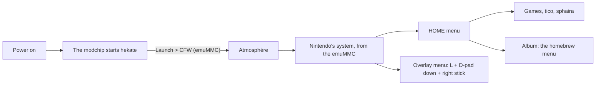
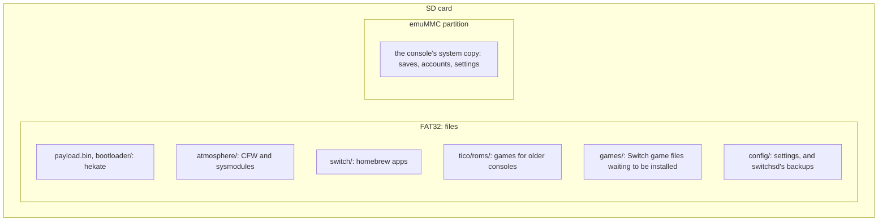

# How it all fits together

A short guide for a first-time user: what each piece is, what switchsd does, and what is left to
do on the console. The [README](../README.md) is the reference for every command and option, and
[Which homebrew, and why](homebrew.md) explains each component.

## The pieces

| Piece | What it is | Where it lives |
| --- | --- | --- |
| Modchip, or RCM on early consoles | Starts hekate instead of Nintendo's own boot code | Inside the console |
| hekate | The boot menu: chooses what to start, and has tools for backups, partitions and the battery | `payload.bin` and `bootloader/` on the card |
| Atmosphère | The custom firmware (CFW): starts Nintendo's own system with the changes that let homebrew run | `atmosphere/` on the card |
| emuMMC | A copy of the console's system on the card. CFW runs from it, so the console's own system stays untouched. | A partition of its own on the card |
| sysMMC | The console's own system, on its internal storage | Inside the console |
| Homebrew | Apps (`.nro` files), overlays and sysmodules | `switch/`, `switch/.overlays/` and `atmosphere/contents/` on the card |
| switchsd | This tool: puts all of the above on the card, checks it, updates it, and backs it up | Your computer |

## What happens when the console starts



- hekate shows its menu at every start from power-off, and **Launch > CFW (emuMMC)** starts the
  system. The card's boot menu has no entry for the console's own system.
- CFW is the same system as on any Switch. Nintendo's servers are blocked under it, so it does not
  go online to Nintendo.
- Waking the console from sleep goes straight back to where it was, without hekate.

## What is on the card



`setup` writes only the files on the left, and never touches the emuMMC, `Nintendo/` (installed
games), `JKSV/` (save backups) or a settings file you have changed.

## Getting started

### If the card already starts CFW

1. Put the card in the computer's card reader.
2. Run:

   ```sh
   git clone https://github.com/26zl/switchsd && cd switchsd && python3 switchsd.py setup
   ```

   Without git, download the ZIP from GitHub (Code > Download ZIP), unpack it, and run
   `python3 switchsd.py setup` in that folder. On Windows, `py` takes the place of `python3`.
3. `setup` finds the card, installs or updates the 31 standard components, and prints anything left
   to do on the console. Eject the card safely and put it back in the console.
4. If the console's own storage has never been backed up, do that next:
   [Back up the console's own storage](#back-up-the-consoles-own-storage).

### If the card is new or empty

1. `python3 switchsd.py disks` lists the cards with their name and exact size.
2. `new` formats the card the way hekate does and puts everything on it. For the copy of a whole
   32 GB system (Lite, V1, V2) on macOS:

   ```sh
   sudo python3 -I switchsd.py new disk6 --expect-bytes 250139901952 --emummc full
   ```

   The disk name and size are the ones `disks` printed. The README's
   [A new card](../README.md#a-new-card) has the other sizes, and the commands for Linux and Windows.
3. Put the card in the console. When hekate starts, first
   [back up the console's own storage](#back-up-the-consoles-own-storage). Then choose
   **emuMMC > Create emuMMC > SD Partition > Part 1**, which copies the console's system to the card,
   and then **Launch > CFW (emuMMC)**.

### Back up the console's own storage

Do this once, before anything else on the console. If the console's own storage is ever damaged,
this backup is the way back. switchsd backs up cards, not the console; hekate does that.

1. In hekate, choose **Tools > Backup eMMC**.
2. Choose **eMMC BOOT0 & BOOT1**, and when that is done, **eMMC RAW GPP**. The second copies the
   whole storage, about 31 GB, or about 62 GB on an OLED. On a card without that much free space,
   hekate makes the backup in parts and says when to move them off the card.
3. Turn the console off, put the card in the computer and copy its `backup/` folder somewhere
   safe. Once it is copied, it can be deleted from the card to free the space.

The backup belongs to this one console: never share it. Making it is hekate's own feature, not
tried with this tool.

## On the console, once

`setup` lists these when they apply.

1. **Put tico on the HOME menu.** tico, the emulator menu, needs a game's full memory and will not
   run from the Album. In the homebrew menu (Album), start sphaira, highlight tico and choose
   **Options (X) > Install Forwarder > Create Forwarder**. tico gets its own icon on the HOME menu.
   If sphaira says installing is disabled, as on a card first set up by an older switchsd, turn it
   on: **Menu (Y) > Advanced Options > Install options > Enable emummc**. Installing to the
   console's own system stays off.
2. **Install emulators.** Start tico from its icon. **Store > Apps** lists its emulators: install
   the ones you want.
3. **Optional: give sphaira an icon too.** Highlight sphaira itself and do the same. Homebrew
   started from that sphaira gets a game's full memory, which apps such as Autorun need.
4. **Optional: remote control.** In the overlay menu (L + D-pad down + right stick), **Sysmodules**
   switches sys-botbase on, and `switchsd.py remote` then reaches the console over Wi-Fi. It is off
   after every restart.

## Everyday use

| To | Use |
| --- | --- |
| Play games for older consoles | tico, from the HOME menu. Game files go in `tico/roms/<console>/`, for example `tico/roms/snes/`, and appear by themselves. |
| Install your own Switch games | `switchsd.py games FILE` copies them to `games/` on the card; on the console, DBI installs them from there (Browse SD card > games). Not tried yet. |
| Start other homebrew | The Album opens the homebrew menu, with limited memory; the sphaira icon gives the full memory |
| See clocks, temperatures, the battery; switch sysmodules; cheats | The overlay menu: L + D-pad down + right stick |
| Back up saves | JKSV |
| Stream games from a PC, or Xbox Cloud Gaming | Moonlight, green-nx |

Some emulators need BIOS files from your own consoles, in `tico/system/<emulator>/`: PlayStation,
PlayStation 2, Saturn, Sega CD and the DS, the Dreamcast unless its HLE BIOS setting is on, and a
few rarer systems; tico's [BIOS Setup Guide](https://forum.ticoverse.com/topic/18) lists the files.
NES, SNES, Game Boy, N64, PSP, GameCube, Wii and 3DS games run without.

## Keeping it up to date

```sh
cd switchsd
git pull                        # the newest pins
python3 switchsd.py setup       # writes only what changed
```

- Every new version of a component is looked at before it is pinned, and every download is checked
  against its pin. `python3 switchsd.py check` says when the card holds older versions than the
  pinned ones.
- Before it changes anything, `setup` copies every file it replaces or removes. If the console
  misbehaves afterwards, `python3 switchsd.py undo` puts the card back as it was; run again, it
  goes back one more update.
- If a project replaced a file after it was pinned, `setup` leaves that component as it is, says
  so and updates the rest. A later `git pull` brings it.
- tico, its emulators and Autorun update themselves: in tico, **Store > Installed**.
- The console's firmware does not need updating for any of this. Atmosphère supports firmware up to
  a version that `check` names, and `setup` refuses an Atmosphère too old for the firmware the card
  last started. Never use System Settings > System Update under CFW.

### Updating the emuMMC's firmware

Only a game that asks for newer firmware makes this necessary. switchsd fetches no firmware. These
steps copy the firmware of the console's own system into the emuMMC, with two tools that `setup`
puts on the card. Both are those projects' own features, not tried with this tool.

1. Bring the card up to date first (`git pull`, then `setup`), and run `check`: it names the newest
   firmware the pinned Atmosphère supports. Go no further than that.
2. Copy the firmware off the console's own system. In hekate, choose **Payloads >
   TegraExplorer-Ext**. Under **Scripts**, choose **FirmwareDump.te**, then **Dump sysmmc**, and
   press A. The firmware lands in `tegraexplorer/Firmware/<version>/` on the card. Choose nothing
   else in that list: **SystemWipe.te** erases a system. **Reboot to Hekate** goes back.
3. Install it into the emuMMC. Start CFW, open the homebrew menu (Album) and start **Daybreak**.
   Choose **Install**, then the folders `tegraexplorer`, `Firmware` and the version. Once Daybreak
   says the update is valid, choose **Continue**, **Preserve settings**, **Install (FAT32 +
   exFAT)** and **Continue**, and at the end **Reboot**.

The emuMMC gets the firmware the console's own system has, which is newer only if that system was
updated after the emuMMC was made. [TegraExplorer-Ext](https://github.com/sthetix/TegraExplorer-Ext)
and Daybreak, part of [Atmosphère](https://github.com/Atmosphere-NX/Atmosphere), are documented by
their projects.

## Backups

| What | How | When |
| --- | --- | --- |
| What one `setup` changed | `undo`, from the copies `setup` keeps on the card | After an update that misbehaves |
| The whole card, emuMMC included | `sudo python3 -I switchsd.py image disk6 card.swimg` | Before big changes, and now and then |
| Back onto a card | `restore`, onto any card it fits; `clone`, onto a bigger one | A lost, broken or too small card |
| The console's own storage | hekate: [Tools > Backup eMMC](#back-up-the-consoles-own-storage), then copy it off the card | Once, before anything else; hekate's own feature, not tried with this tool |

Keep the copy of hekate's `backup/` folder, and Atmosphère's copy of the console's PRODINFO in
`atmosphere/automatic_backups/`. They belong to this one console: never share them.

## When something is off

| What you see | What it means | What to do |
| --- | --- | --- |
| tico says "Applet Mode Detected" | It was started from the Album | Start it from its HOME icon (On the console, once: step 1) |
| DBI lists keys missing from `/switch/prod.keys` | DBI's own notice: some of its functions use the console's keys, which switchsd does not put on the card | B closes it; DBI's menu is behind it |
| hekate's menu at every start | That is how the card is set up | Launch > CFW (emuMMC) |
| `setup` stops: Atmosphère cannot start the firmware | The console's firmware is newer than the pinned Atmosphère supports | `git pull` for newer pins; `updates` shows whether a newer Atmosphère is out |
| `check`: newer versions pinned | The card is behind | `setup` |
| `check`: tico has no emulators yet | Step 2 above is still to do | tico > Store > Apps |
| `remote`: nothing answers | sys-botbase is off, or the console is asleep | Overlay menu > Sysmodules > sys-botbase |
| A game file of 4 GB or more copied on macOS is not seen | Its folder of parts lacks FAT's archive bit | hekate: Tools > Arch bit > Fix Archive Bit |
| Something misbehaves after an update | | `python3 switchsd.py undo` |
| `setup` refuses a release whose layout changed | A project changed how it packs its files | Use the pinned versions; it gets fixed in the next update of this tool |
| `setup`: "Left out, because nothing unchecked goes on a card" | A project replaced a file after it was pinned. That component stays as it was; the rest is set up | Nothing on the card: `git pull` later and run `setup` again |
| `setup` stops: "a card needs … to start CFW" | The same, for hekate, Atmosphère or sys-patch. Nothing was changed | `git pull` later and run `setup` again |

## Words

| Word | Meaning |
| --- | --- |
| CFW | Custom firmware: here Atmosphère, which runs Nintendo's system with homebrew allowed |
| emuMMC, sysMMC | The system copy on the card, and the console's own system |
| Payload | A program the modchip or RCM starts before any system: hekate, or a tool such as TegraExplorer |
| Homebrew menu | The list of apps in `switch/`, opened from the Album |
| Applet mode | How an app runs from the Album: with a fraction of the memory a game gets |
| Forwarder | A HOME-menu icon that starts a homebrew app as if it were a game, with the full memory |
| Sysmodule | A background program that starts with the system, such as MissionControl for other consoles' controllers |
| Overlay | A menu drawn on top of whatever runs, opened with L + D-pad down + right stick |
| NRO, NSP | A homebrew app; an installable package, such as a game or a forwarder |
